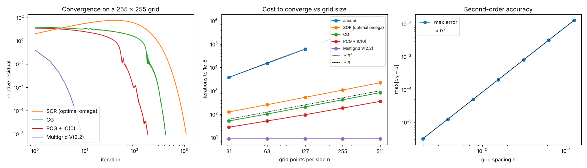
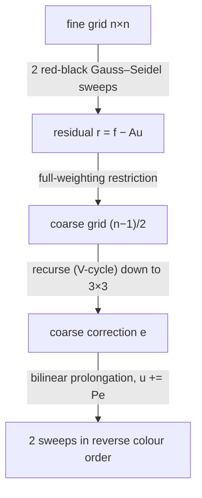

# cg-poisson

Five ways to solve the 2D Poisson equation −∇²u = f on the unit square, written matrix-free in C++20:
Jacobi, red-black SOR, conjugate gradient, IC(0)-preconditioned CG and geometric multigrid. Each is
measured on how its cost grows as the grid gets finer.



## Results

Iterations, and wall time, to reach a relative residual of 10⁻⁸ (single thread, GCC 13 `-O3`, cloud VM):

| n (grid n×n) | Jacobi | SOR, optimal ω | CG | PCG + IC(0) | Multigrid V(2,2) |
|---:|---:|---:|---:|---:|---:|
| 31 | 3,806 (11 ms) | 126 (0.5 ms) | 52 (0.2 ms) | 28 (0.2 ms) | **9** (0.2 ms) |
| 63 | 15,236 (179 ms) | 258 (3.6 ms) | 103 (1.5 ms) | 52 (2.2 ms) | **9** (0.5 ms) |
| 127 | 60,953 (3.0 s) | 531 (30 ms) | 207 (12 ms) | 96 (20 ms) | **9** (2.2 ms) |
| 255 | — | 1,090 (253 ms) | 419 (114 ms) | 185 (201 ms) | **9** (9.2 ms) |
| 511 | — | 2,238 (2.4 s) | 846 (1.3 s) | 356 (1.6 s) | **9** (38 ms) |

What the table shows:

- **Jacobi** needs O(n²) iterations, because its error decays as $1 - O(h^2)$ per sweep.
- **SOR** with $\omega_{\rm opt} = 2/(1+\sin\pi h)$ and **CG** both need O(n). CG's iteration count grows as
  $\sqrt{\kappa}$, and $\kappa(A) \sim h^{-2}$.
- **IC(0)** halves CG's iterations, but each application is two sequential triangular solves. So here
  it is *slower* overall: fewer iterations doesn't always mean less time.
- **Multigrid** needs a constant 9 cycles at every size. Smoothing removes high-frequency error, and
  the coarse grids remove the rest, so the total work is O(N). At n = 511 it is 34× faster than CG.

## Discretisation

$$(A u)_{ij} = \frac{4u_{ij} - u_{i-1,j} - u_{i+1,j} - u_{i,j-1} - u_{i,j+1}}{h^2}, \qquad h = \frac{1}{n+1}$$

This is the 5-point stencil, which is symmetric positive definite. Its truncation error is
$\frac{h^2}{12}(u_{xxxx} + u_{yyyy})$, and the measured order is exactly 2:

| n | h | max error | observed order |
|---:|---:|---:|---:|
| 63 | 1.56e-2 | 2.01e-4 | 2.001 |
| 127 | 7.81e-3 | 5.02e-5 | 2.000 |
| 255 | 3.91e-3 | 1.26e-5 | 2.000 |
| 511 | 1.95e-3 | 3.14e-6 | 2.000 |

**Choosing a test problem.** The obvious manufactured solution, u = sin(πx) sin(πy), is an exact
eigenvector of the discrete Laplacian, so CG solves it in one iteration. A solver comparison built on it
would be meaningless (the test suite caught this). It is used only for the order-of-accuracy study.
Solvers are compared on u = x(1−x)·y(1−y), which the stencil reproduces exactly, so any remaining
error is purely algebraic.

## Algorithms



- **IC(0)**. For the 5-point stencil the incomplete Cholesky factor keeps A's sparsity, so it is fully
  defined by one pivot recurrence, $d_{ij} = 4 - 1/d_{i-1,j} - 1/d_{i,j-1}$, with
  $M = (D+L)D^{-1}(D+L^T)$.
- **Red-black ordering** decouples each colour's updates, which is the standard route to parallel
  Gauss–Seidel. It also doubles as the multigrid smoother.

## Tests

| test | what it checks |
|---|---|
| `laplacian_is_symmetric` | (Au, v) = (u, Av) for random u, v |
| `discretisation_error_is_second_order` | observed order is between 1.9 and 2.1 on four grids |
| `all_solvers_reach_the_exact_discrete_solution` | all five solvers hit the exact answer to 1e-9 |
| `cg_converges_within_the_number_of_unknowns` | CG's finite-termination property |
| `ic0_preconditioning_cuts_cg_iterations` | at least a 40 % reduction at n = 127 |
| `optimal_sor_is_far_faster_than_gauss_seidel` | ω_opt needs under 20 % of Gauss–Seidel's sweeps |
| `multigrid_cycle_count_does_not_grow_with_grid_size` | cycle count is flat from 31² to 255² |

## Build and run

```bash
cmake -S . -B build -DCMAKE_BUILD_TYPE=Release
cmake --build build -j
ctest --test-dir build --output-on-failure
./build/convergence docs/data && python scripts/plot.py docs/data docs/convergence.png
```

## Next steps

Use multigrid as a preconditioner for CG (MGCG); add variable coefficients −∇·(k∇u) = f, where IC(0)
and plain smoothers degrade but multigrid with Galerkin coarse operators still works; and use an
OpenMP red-black smoother.

## License

Copyright (c) 2026 Ankit Pawar. All Rights Reserved.

This repository is public so that the work can be read and evaluated, but it is not open source. Using, copying, modifying, redistributing or commercially exploiting any part of it requires prior written permission. This does not affect what applicable law allows without permission, or viewing and forking the repository on GitHub under GitHub's Terms of Service. The full terms are in [LICENSE](LICENSE).

Commits up to and including `2eed246` were released under the MIT License, and copies obtained under those terms keep them.

For licensing or collaboration, email ankitpawar0007x@gmail.com or visit [ankitinorbit.com](https://ankitinorbit.com).
